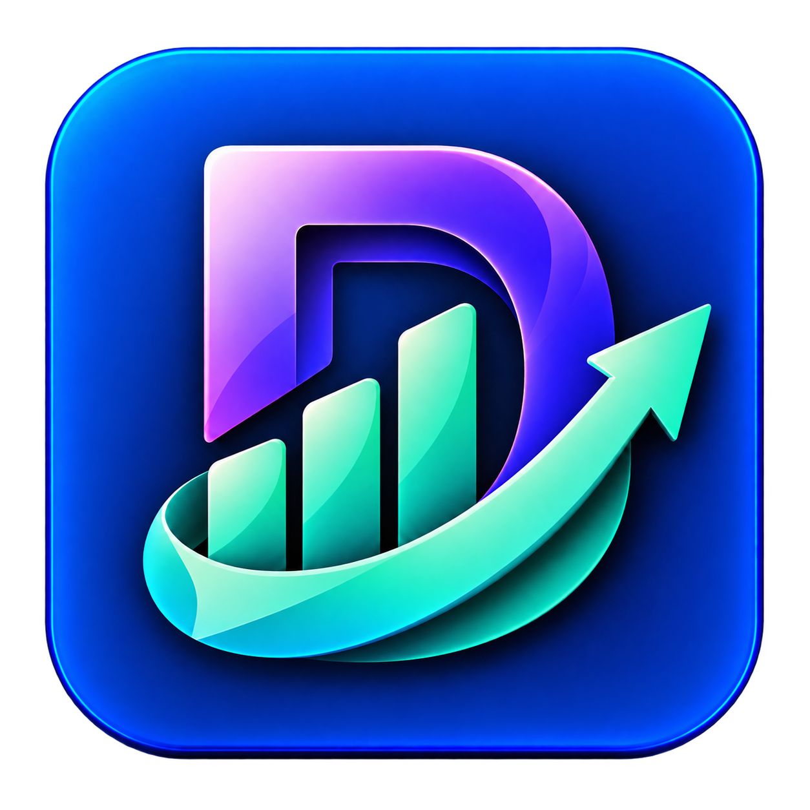

 <p align="center">
  
</p>

<h1 align="center">DHANVIQ</h1>

<p align="center">
  <strong>Track. Save. Grow.</strong>
  <br/>
  A smarter way to manage your money.
</p>

<p align="center">
  
  
  
  
</p>

---

## 📖 About DHANVIQ

DHANVIQ is a personal finance management application built with Flutter and Dart. It helps users track income and expenses, manage monthly budgets, set savings goals, and understand their spending habits through financial insights.

The goal is to make everyday money management simple and convenient through a clean, user-friendly mobile experience.

## 📱 App Preview

<p align="center">
  
  &nbsp;&nbsp;
  
</p>

<p align="center">
  <em>Track your money. Build better habits. Work toward your goals.</em>
</p>

---

## ✨ Features

- **Home Dashboard** — View your financial summary and recent transactions.
- **Income Tracking** — Record and organize income entries.
- **Expense Management** — Track daily expenses and categories.
- **Transaction History** — Review recorded transactions.
- **Financial Insights** — Understand spending through available analytics and charts.
- **Monthly Budgeting** — Set budgets and monitor spending limits.
- **Savings Goals** — Create financial goals and track progress.
- **Profile Management** — View and manage profile details.
- **Settings** — Access available account and app preferences.
- **Local Storage** — Store supported data locally according to the app implementation.

## 🖼️ Screenshots

### 1. Splash Screen

<p align="center">
  
</p>

### 2. Home Dashboard

<p align="center">
  
</p>

### 3. Transactions

<p align="center">
  
</p>

### 4. Add Income

<p align="center">
  
</p>

### 5. Add Expense

<p align="center">
  
</p>

### 6. Financial Insights

<p align="center">
  
</p>

### 7. Monthly Budget

<p align="center">
  
</p>

### 8. Savings Goals

<p align="center">
  
</p>

### 9. Settings

<p align="center">
  
</p>

### 10. Profile

<p align="center">
  
</p>

---

## 🛠️ Tech Stack

| Technology | Purpose |
|---|---|
| Flutter | Mobile application framework |
| Dart | Application programming language |
| SharedPreferences / local storage | Local persistence, as implemented in the project |
| Android | Mobile platform |

## 🚀 Getting Started

### Prerequisites

- Flutter SDK
- Dart SDK (included with Flutter)
- Android Studio or Visual Studio Code
- Android emulator or physical Android device

### Installation

**1. Clone the repository**

```bash
git clone https://github.com/utsavsingh1920/DHANVIQ.git
```

**2. Navigate to the project directory**

```bash
cd DHANVIQ
```

**3. Install dependencies**

```bash
flutter pub get
```

**4. Run the application**

```bash
flutter run
```

## 📂 Project Structure

```text
DHANVIQ/
├── android/
├── assets/
│   └── icon/
│       └── dhanviq_icon.png
├── lib/
│   ├── home/
│   └── settings/
├── screenshots/
│   ├── 01_splash.jpeg
│   ├── 02_home.jpeg
│   ├── 03_transactions.jpeg
│   ├── 04_add_income.jpeg
│   ├── 05_add_expense.jpeg
│   ├── 06_insights.jpeg
│   ├── 07_budget.jpeg
│   ├── 08_goals.jpeg
│   ├── 09_settings.jpeg
│   └── 10_profile.jpeg
├── test/
├── pubspec.yaml
└── README.md
```

## 🎯 Project Vision

DHANVIQ aims to make personal finance management more accessible by bringing income tracking, expense management, budgeting, savings goals, and financial insights together in one mobile application.

## 👨‍💻 Developer

Built with Flutter and Dart.

---

<p align="center">
  
  <br/>
  <strong>DHANVIQ</strong>
  <br/>
  <em>Track Better. Save Smarter. Grow Confidently.</em>
</p>
