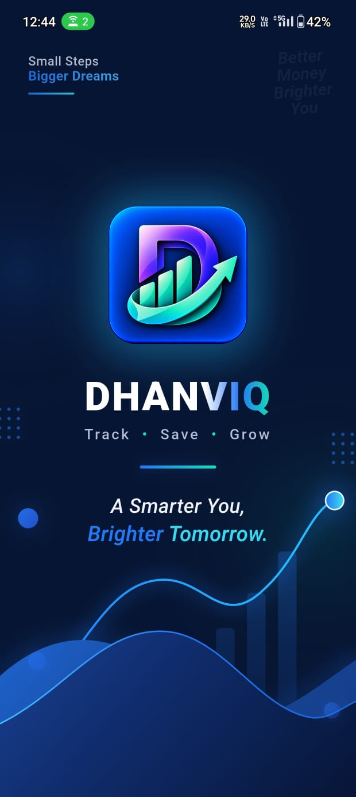
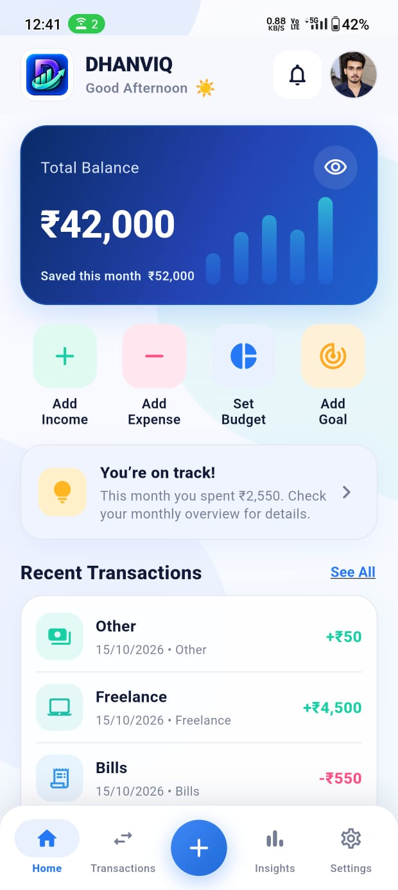
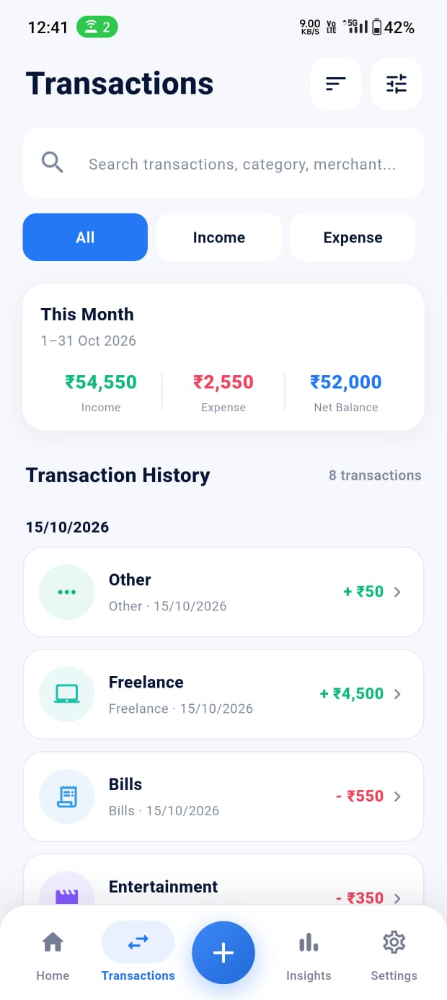
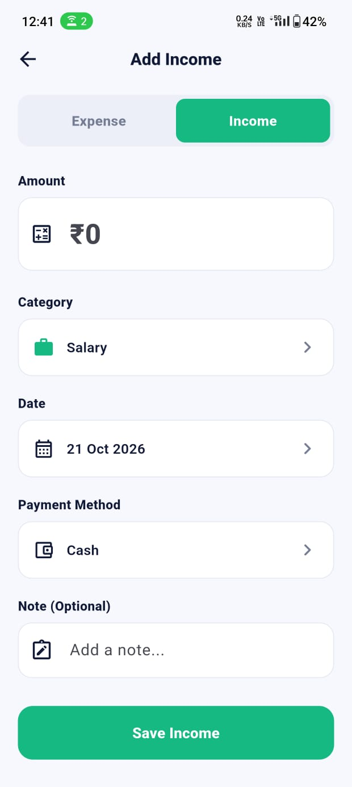
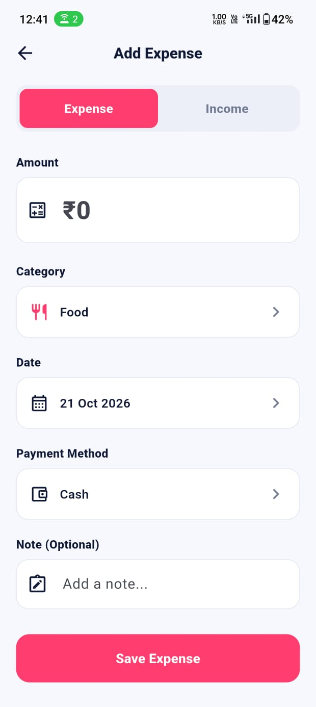
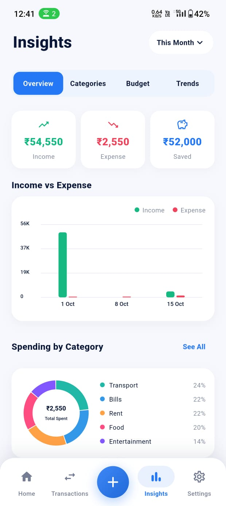
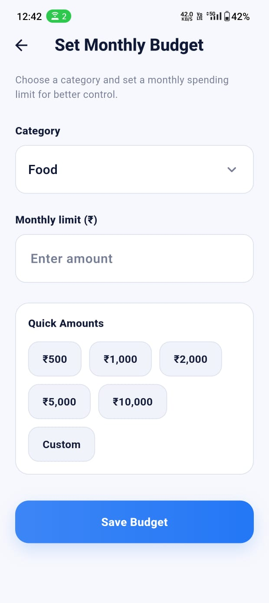
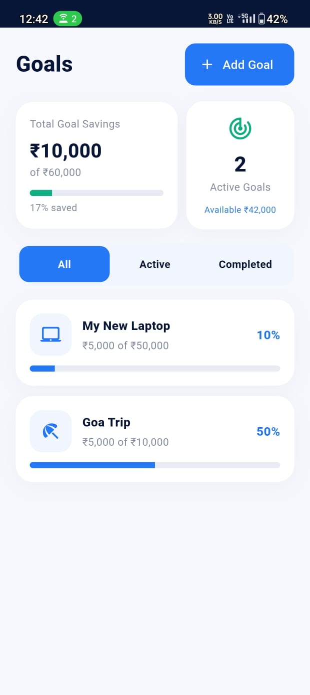
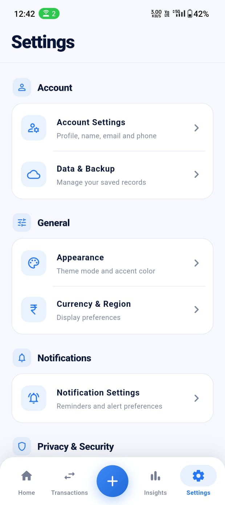
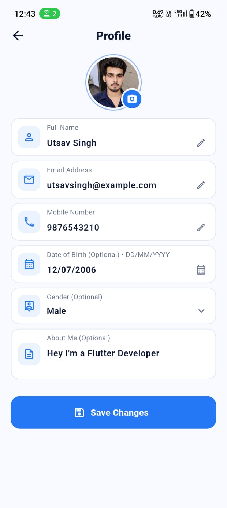

#  DHANVIQ

### Track. Save. Grow.

**A smarter way to manage your money.**

DHANVIQ is a personal finance management application built with Flutter and Dart. It helps users track income and expenses, manage monthly budgets, set savings goals, and understand spending habits through financial insights.

<p align="center">
  
  
  
  
</p>

---

## 📱 App Preview

<p align="center">
  
  
</p>

<p align="center">
  <em>Small Steps. Bigger Dreams. — Track, Save and Grow with DHANVIQ.</em>
</p>

## ✨ Features

- **Home Dashboard** — View your balance, monthly savings and recent transactions.
- **Income Tracking** — Record income with categories, dates and payment methods.
- **Expense Management** — Record and organize daily expenses.
- **Transaction History** — Review transactions with available search and filtering.
- **Financial Insights** — Explore income, expenses and category-wise spending charts.
- **Monthly Budgeting** — Set category-based spending limits.
- **Savings Goals** — Set financial goals and monitor progress.
- **Profile Management** — Manage your profile details.
- **Settings** — Access account, appearance, currency, notification and privacy preferences.
- **Local Data Storage** — Keep supported financial data on the device according to the app's implementation.

## 🖼️ Screenshots

### 1. Home Dashboard

<p align="center">
  
</p>

### 2. Transactions

<p align="center">
  
</p>

### 3. Add Income & Expense

<p align="center">
  
  &nbsp;&nbsp;
  
</p>

### 4. Financial Insights

<p align="center">
  
</p>

### 5. Monthly Budget

<p align="center">
  
</p>

### 6. Savings Goals

<p align="center">
  
</p>

### 7. Settings & Profile

<p align="center">
  
  &nbsp;&nbsp;
  
</p>

## 🛠️ Tech Stack

| Technology | Purpose |
|---|---|
| Flutter | Cross-platform UI framework |
| Dart | Application programming language |
| SharedPreferences / local storage | Local persistence, as implemented in the project |
| Android | Mobile deployment target |

## 🚀 Getting Started

### Prerequisites

- Flutter SDK
- Dart SDK (included with Flutter)
- Android Studio or Visual Studio Code
- Android emulator or a physical Android device

### Installation

**1. Clone the repository**

```bash
git clone https://github.com/utsavsingh1920/DHANVIQ.git
```

**2. Open the project directory**

```bash
cd DHANVIQ
```

**3. Install dependencies**

```bash
flutter pub get
```

**4. Run the application**

```bash
flutter run
```

## 📂 Project Structure

```text
DHANVIQ/
├── android/
├── assets/
│   └── images/
│       └── dhanviq_logo.png
├── lib/
├── screenshots/
│   ├── 01_splash.jpeg
│   ├── 02_home.jpeg
│   ├── 03_transactions.jpeg
│   ├── 04_add_income.jpeg
│   ├── 05_add_expense.jpeg
│   ├── 06_insights.jpeg
│   ├── 07_budget.jpeg
│   ├── 08_goals.jpeg
│   ├── 09_settings.jpeg
│   └── 10_profile.jpeg
├── test/
├── pubspec.yaml
└── README.md
```

## 🎯 Vision

DHANVIQ aims to make personal finance management simpler by bringing everyday money tracking, budgeting, savings goals and spending insights into one convenient application.

## 👨‍💻 Developer

Built with Flutter and Dart.

---

<p align="center">
  <strong>DHANVIQ</strong><br/>
  <em>A Smarter You, Brighter Tomorrow.</em>
</p>
